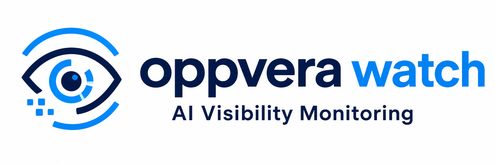

# Oppvera Watch

**Oppvera Watch** is a **desktop capture client** for [Oppvera](https://oppvera.com), on macOS and Windows. It opens real consumer AI product UIs (ChatGPT, Claude, Gemini, Perplexity, Google AI Overview), records what those pages render, and uploads **answer text and citations** to a paired campaign.

GEO scores, dashboards, and query-bank editing live on **hosted Oppvera**. This app does not score, chart, or store analytics locally.

**Status (October 2026):** macOS client **0.6.0-alpha** pairs to Oppvera, runs the campaign query bank, queues captures offline (including failed checks), and syncs to the shared visibility store. Failed checks upload as outcomes so Oppvera does not treat them as “brand absent.” Schedules stay on this computer; hosted email does not start a capture. Hosted Oppvera scores rows, filters Watch vs Probe on the campaign visibility page, and shows a UI-vs-API compare panel when both sources exist for the same bank question. Engineering detail: [docs/plans/README.md](docs/plans/README.md).

The capture engine started as a fork of [OneGlanse](https://github.com/aryamantodkar/oneglanse). This repository is the desktop client. Original OneGlanse features (dashboard, Docker, analysis keys) live on that upstream repo if you need to look them up. Do not merge `oneglanse/main`.

## Install

1. On the campaign **Visibility** page in Oppvera, choose **Download Oppvera Watch** (macOS, Apple silicon). The file is also attached to [GitHub Releases](https://github.com/oppvera/oppvera-watch/releases/latest).
2. Open the `.dmg` and drag **Oppvera Watch** to Applications.
3. Current releases are **notarized** (open normally after install). Older unsigned builds may need `xattr`; see [releasing-macos.md](docs/runbooks/releasing-macos.md).
4. Install [Python 3.12](https://www.python.org/downloads/) if the app asks, then use **Set up Camoufox Python** once.
5. Paste a pairing code from that campaign’s Visibility page. Repeat for each campaign you want on this computer (one code per campaign).

You do not need Node.js, Git, or this repository to use the Mac installer. On Windows, run Oppvera Watch from this repository with `pnpm dev:desktop`.

## How it works

1. Pair with `https://oppvera.com` (or `http://127.0.0.1:8000` for a local Oppvera). **Settings** stores every paired campaign under its company. Select one. **Query bank** and **Run** use only that campaign.
2. Connect the consumer accounts you already pay for. Logins stay on this computer and are shared across paired campaigns.
3. The query bank is read-only. Edit questions in Oppvera.
4. Run connected providers one at a time for the selected campaign. Stop ends the capture, including the Camoufox browser window.
5. Sync uploads pending captures (each row uses the token for the campaign it was captured under). Oppvera scores them. Watch never asks for an analysis key.

### One campaign at a time (Settings)

Settings is the simple path. Paste a pairing code for each campaign you want on this computer. The list shows those campaigns under their company. The radio selects **one**. Query bank and Run follow that selection, even if six campaigns are stored.

To add another campaign, paste another code on Settings.

### Several campaigns (Advanced settings)

Open **Advanced settings** with the button on **Settings**. Clicking the version label in the footer does not open it.

Advanced settings is for running more than the one selected campaign:

- Each company has one weekday and local hour. Check the campaigns to include. **Select all** checks every campaign under that company. **Pause** grays that company and stops the automatic run until you press **Resume**. **Run now** still starts the checked campaigns. A campaign you pair later stays unchecked until you add it and save. The radio that selects one campaign stays on Settings.
- **Custom schedule** runs several companies together on one day and hour. You can save more than one custom row, so Tuesday and Thursday can each have their own mix.
- **Run now** under a company, or under a custom row, runs those campaigns one after another. There is no cap on how many campaigns are included.
- If two schedules are due at the same time, each campaign still runs once, in order.
- Runs are not parallel. Providers stay the last ones you used on **Run**, or ChatGPT and Claude if you have not run yet.

Settings shows a short summary of the days that are turned on.

| What a schedule does | What it does not do |
| --- | --- |
| Runs while Oppvera Watch is **open** (minimized is OK) | Run after you **quit** the app |
| Uses your last **Run** providers (or ChatGPT + Claude by default) | Start captures from hosted Oppvera or email reports |
| At most **once per calendar week** for each saved schedule | Phone home on a timer — see below |

**Trust and network behavior:** While a schedule is on, the app looks at the **local clock every 5 minutes** to see whether it is time to start a run. Those checks are **on-device only** (no Oppvera API calls, no telemetry ping). Data leaves this computer only when you **capture** answers and **sync** them, same as a manual run.

Hosted Oppvera can send **visibility report emails** on its own schedule; that email does **not** open ChatGPT or start Watch.

Details: [apps/desktop/README.md](apps/desktop/README.md).

## Developer console

Capture logs appear in Chromium DevTools.

- Alpha builds open the panel at the bottom when Oppvera Watch starts.
- Choose **View → Toggle Developer Tools**, or press Option-Command-I (⌥⌘I) on a Mac, or Ctrl+Shift+I on Windows.
- Use the **Console** tab.

See [apps/desktop/README.md](apps/desktop/README.md) for `WATCH_OPEN_DEVTOOLS` and verbose capture logging.

## Requirements

| Who | Need |
| --- | --- |
| Anyone capturing | macOS or Windows, Python 3.10+, network, and a pairing code per campaign you capture |
| Signed-in captures | Your consumer logins in the Camoufox window |
| Developers | Node.js 20+, pnpm 10+, this git checkout |

## Develop

```bash
git clone https://github.com/oppvera/oppvera-watch.git
cd oppvera-watch
pnpm install
pnpm dev:desktop
```

To build a `.dmg` and publish it, see [docs/runbooks/releasing-macos.md](docs/runbooks/releasing-macos.md).

Camoufox is pinned in `apps/desktop/src/python.ts` (`CAMOUFOX_PIP_SPEC`). It does not track the newest PyPI release on its own. Before a release, compare that pin with [camoufox on PyPI](https://pypi.org/project/camoufox/) and follow [apps/desktop/README.md](apps/desktop/README.md#camoufox-package-pin).

## Data that stays on the Mac

Under `~/Library/Application Support/Oppvera Watch/`:

- Playwright session files (cookies / `storageState`)
- Device pairing tokens (one per paired campaign)
- Unsynced capture files

The Camoufox browser downloaded by Watch is cached at `~/Library/Caches/camoufox` (the Camoufox installer has no custom directory flag).

Watch uploads question text, answer markdown, citations, provider labels, and ids. It never uploads cookies, `storageState`, passwords, or localStorage.

## Internal staff previews

Partner installs use [GitHub Releases → Latest](https://github.com/oppvera/oppvera-watch/releases/latest) (Visibility download). For **internal QA only**:

| Release | Status |
| --- | --- |
| [v0.7.4-preview](https://github.com/oppvera/oppvera-watch/releases/tag/v0.7.4-preview) | **Current** staff preview (macOS DMG; Windows installer when posted). Tracks [PR #34](https://github.com/oppvera/oppvera-watch/pull/34). |
| [v0.7.3-preview](https://github.com/oppvera/oppvera-watch/releases/tag/v0.7.3-preview) | **Deprecated** — superseded by 0.7.4; **assets removed**. Do not install. |
| [v0.7.2-windows-preview](https://github.com/oppvera/oppvera-watch/releases/tag/v0.7.2-windows-preview) | **Deprecated** — broken query-bank capture; **assets removed**. Do not install. |

## Documentation

- [apps/desktop/README.md](apps/desktop/README.md) — desktop develop notes
- [docs/runbooks/releasing-macos.md](docs/runbooks/releasing-macos.md) — produce a `.dmg` and publish it
- [docs/runbooks/releasing-windows.md](docs/runbooks/releasing-windows.md) — produce a Windows installer (maintainers; desktop v2)
- [docs/plans/README.md](docs/plans/README.md) — Watch / Probe specs (not a consumer install guide)

## License

This project is **MIT licensed**. See [LICENSE](LICENSE).

- Original capture project: **Aryaman Todkar / OneGlanse**
- This fork and desktop product: **Craig Oda / Oppvera Watch**

Suggested credit:

> Based on [OneGlanse](https://github.com/aryamantodkar/oneglanse) (MIT) and [Oppvera Watch](https://github.com/oppvera/oppvera-watch) (MIT).

**Trademark note:** "OneGlanse" is the upstream project name. Oppvera Watch is an independent fork and is not an official OneGlanse release.

Application code is MIT. Camoufox, Playwright, Electron, and other packages ship under their own licenses.
